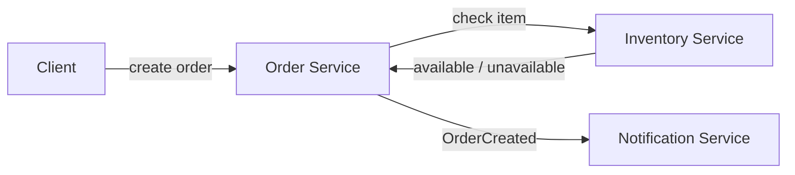

# CMPE 273 - Assignment 3

This is a simple online store with Order, Inventory, and Notification parts. I only built Order and Inventory as services because the required implementation is Order Service calling Inventory Service. After an order is created, the Order Service prints an `OrderCreated` event to represent what Notification Service would receive.

## Architecture



## Service boundaries and data

- **Order Service** creates orders and keeps the order ID, item, quantity, and status.
- **Inventory Service** keeps the item quantities and checks availability.
- **Notification Service** would send a notification after an order is made and keep any notification history.

I kept these separate because they do different jobs. Order Service does not need to manage stock values, and Inventory Service does not need to know how orders are stored. If notifications change later, that should not affect the order or inventory code.

## Command, Query, and Event

- **Check item availability** is a **Query** because it only reads inventory data.
- **Create an order** is a **Command** because it adds an order.
- **OrderCreated** is an **Event** because it says that an order was already created.

## Setup

From the project folder:

```bash
python3 -m venv .venv
source .venv/bin/activate
pip install -r requirements.txt
```

## Run it

Open two terminals in the project folder.

**First terminal**

```bash
source .venv/bin/activate
python inventory_service.py
```

**Second terminal**

```bash
source .venv/bin/activate
python order_service.py
```

Inventory Service uses port 5001 and Order Service uses port 5000.

## Successful order

**Third terminal**

```bash
source .venv/bin/activate
curl -i -X POST http://127.0.0.1:5000/orders \
  -H 'Content-Type: application/json' \
  -d '{"item_id":"keyboard","quantity":2}'
```

I got a `201 CREATED` response like this:

```json
{"item_id":"keyboard","order_id":1,"quantity":2,"status":"created"}
```

To check the order that was created:

```bash
curl http://127.0.0.1:5000/orders/1
```

## Inventory failure test

Stop Inventory Service with `Ctrl+C`, but keep Order Service running. Then run:

```bash
curl -i -X POST http://127.0.0.1:5000/orders \
  -H 'Content-Type: application/json' \
  -d '{"item_id":"mouse","quantity":1}'
```

The expected result is `503 SERVICE UNAVAILABLE`:

```json
{"error":"Inventory Service is unavailable"}
```

Order Service is still running after that error:

```bash
curl http://127.0.0.1:5000/health
```

```json
{"service":"order","status":"running"}
```

## Reflection

Clear boundaries make it easier to know where each piece of data should live. They also make failures easier to handle because Order Service can return an error if Inventory Service is down instead of crashing. Each service can be changed later without changing everything else. This keeps the system easier to understand as it grows.
