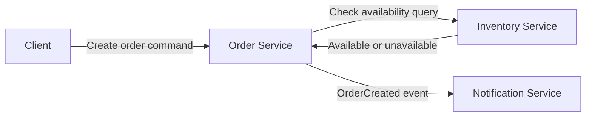

# CMPE 273 Assignment 3 - Architecture and Service Boundaries

This is a small online-store example with Order, Inventory, and Notification responsibilities. I implemented the Order Service and Inventory Service as separate Python processes. Notification is shown as an event-driven component in the architecture; the Order Service prints an `OrderCreated` event after successfully creating an order.

## Architecture



## Responsibilities and data ownership

| Component | Responsibility | Data it owns |
| --- | --- | --- |
| Order Service | Creates orders and lets a client look up an order. | Order ID, item ID, quantity, and order status. |
| Inventory Service | Checks whether enough of an item is available. | Item IDs and available quantities. |
| Notification Service | Would notify a user after an order is created. | Notification delivery status/history. |

I separated these services because each one has a different job and owns different data. For example, Order Service should not directly change Inventory data, and Inventory Service should not need to know how orders are stored. This also means a notification change can be made without changing the inventory-checking logic.

## Command, Query, and Event

| Interaction | Type | Reason |
| --- | --- | --- |
| Check whether an item is available | Query | It reads inventory information and does not change it. |
| Create an order | Command | It changes Order Service data by adding a new order. |
| OrderCreated | Event | It is something that already happened, and Notification Service can react to it. |

## Setup

Run these commands once from the project folder:

```bash
python3 -m venv .venv
source .venv/bin/activate
pip install -r requirements.txt
```

## Run the services

Open two terminals. In both terminals, go to the project folder and activate the virtual environment:

```bash
source .venv/bin/activate
```

Start Inventory Service in the first terminal:

```bash
python inventory_service.py
```

Start Order Service in the second terminal:

```bash
python order_service.py
```

Inventory Service runs on port 5001. Order Service runs on port 5000.

## Successful request

In a third terminal, run:

```bash
curl -i -X POST http://127.0.0.1:5000/orders \
  -H 'Content-Type: application/json' \
  -d '{"item_id":"keyboard","quantity":2}'
```

Example response:

```text
HTTP/1.1 201 CREATED
```

```json
{"item_id":"keyboard","order_id":1,"quantity":2,"status":"created"}
```

The created order can be checked with:

```bash
curl http://127.0.0.1:5000/orders/1
```

## Inventory failure test

Stop Inventory Service with `Ctrl+C`, but leave Order Service running. Then submit another order:

```bash
curl -i -X POST http://127.0.0.1:5000/orders \
  -H 'Content-Type: application/json' \
  -d '{"item_id":"mouse","quantity":1}'
```

Example result:

```text
HTTP/1.1 503 SERVICE UNAVAILABLE
```

```json
{"error":"Inventory Service is unavailable"}
```

Order Service stays running after this error. This can be checked with:

```bash
curl http://127.0.0.1:5000/health
```

```json
{"service":"order","status":"running"}
```

## Reflection

Clear service boundaries make it easier to understand what each part of a distributed system is responsible for. Data ownership prevents multiple services from changing the same data in different ways. It also makes failures easier to isolate because Order Service can handle an Inventory Service failure instead of crashing. As the application grows, each service can be changed or scaled separately.
